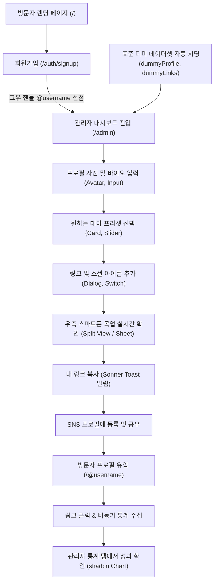
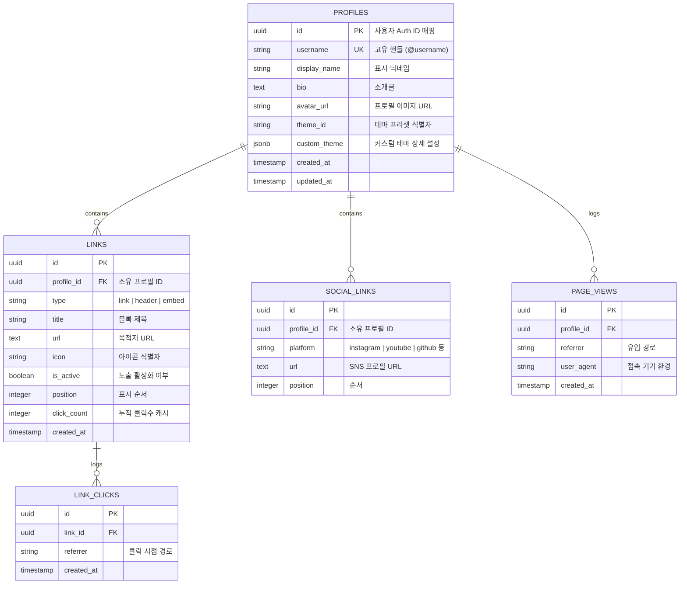

# 📄 [PRD] 마이링크 (MyLink) 제품 요구사항 정의서
> **Product Requirements Document (PRD)**  
> **프로젝트명**: 마이링크 (MyLink) - 링크트리 클론 서비스  
> **버전**: v1.2.0 (표준 더미 데이터셋 채택 반영)  
> **최종 수정일**: 2026-11-15  
> **작성자**: Product & Engineering Team  

---

## 1. 프로젝트 개요 (Executive Summary)

### 1.1 배경 및 기획 의도
- 인스타그램, 틱톡, 트위터(X), 유튜브 등 주요 소셜 미디어 플랫폼은 프로필 소개란에 **단 1개의 외부 링크**만을 허용합니다.
- 크리에이터, 취업준비생, 1인 창업가는 여러 채널(유튜브, 블로그, 포트폴리오, 스마트스토어, 오픈카톡 등)을 동시에 운영하므로, 방문자를 원하는 목적지로 분기시킬 수 있는 **모바일 최적화 바이오 링크(Link-in-bio)** 서비스가 필수적입니다.
- "마이링크"는 누구나 **3분 만에** 자신만의 감각적인 프로필 링크 페이지를 만들고, 실시간 모바일 프리뷰로 편집하며, 방문자 클릭 반응을 분석할 수 있는 링크트리 클론 서비스입니다.

### 1.2 핵심 가치 제안 (Value Proposition)
1. **Zero Coding, 3분 완성**: 누구나 직관적인 UI로 즉시 프로필과 링크를 구성.
2. **실시간 모바일 프리뷰 (WYSIWYG)**: 편집 화면에서 실시간으로 스마트폰 렌더링 결과를 확인하여 디자인 시행착오 최소화.
3. **감각적인 테마 프리셋 & shadcn/ui 기반 일관된 UI**: 완성도 높은 인터랙션 컴포넌트와 원클릭 테마로 최상급 사용자 경험(UX) 제공.
4. **검증된 표준 더미 데이터셋 내장**: 프로토타입 단계부터 실제 서비스 수준의 링크·헤더·임베드 데이터를 활용해 완성도 높은 개발 및 테스트 지원.
5. **데이터 기반 의사결정**: 링크별 실시간 클릭수와 7일간의 방문 트렌드를 직관적으로 제공.

---

## 2. 핵심 의사결정 내역 (Product Clarification & Decisions)

기획 및 기술 사양 확정을 위해 도출한 핵심 질문과 채택된 표준 사양입니다.

| 구분 | 주요 결정 사항 | 채택 내용 및 사유 |
| :--- | :--- | :--- |
| **타겟 유저** | 대중적 바이오 링크 | 개인 크리에이터, 포트폴리오 구직자, 소상공인을 아우르는 모바일 중심 서비스 |
| **URL 라우팅** | `mylink.io/@username` | SNS 프로필에 등록하기 가장 직관적이고 기억하기 쉬운 표준 경로 구조 |
| **인증 체계** | Supabase Auth (Hybrid) | Google 소셜 로그인 + 이메일/비밀번호 지원 및 가입 시 고유 핸들 실시간 선점 |
| **콘텐츠 블록** | 멀티미디어 블록 지원 | 일반 웹 링크, 소셜 아이콘 바, 섹션 헤더/구분선, 유튜브 비디오 임베드 |
| **디자인/테마** | 프리셋 5종 + 세부 커스텀 | 원클릭 프리셋(모던, 다크, 그라데이션 등) + 배경색/버튼 곡률 커스텀 |
| **에디터 UX** | 2-Column Split View | 좌측: 편집 패널 / 우측: 실시간 스마트폰 목업 뷰 (모바일 접속 시 탭 전환) |
| **디자인 시스템**| **shadcn/ui (Tailwind v4)** | **Base UI / Radix 프리미티브 + Tailwind CSS v4 + Lucide Icons 기반 컴포넌트 아키텍처** |
| **더미 데이터셋**| **표준 Mock Data 내장** | **`src/data/links.ts` 기반의 10종 링크 블록 및 프로필 데이터를 개발·시딩에 공식 채택** |
| **통계 수준** | 직관적 핵심 지표 | 프로필 총 조회수(PV), 총 클릭수, 링크별 개별 클릭 뱃지, 7일 트렌드 차트 |
| **기술 스택** | Next.js + Tailwind + Supabase | Next.js 16 (App Router), TypeScript, Tailwind CSS v4, shadcn/ui, Supabase |

---

## 3. 디자인 시스템 규격 (Design System Specification: shadcn/ui)

모든 사용자 인터페이스는 **[shadcn/ui](https://ui.shadcn.com/)** 컴포넌트 아키텍처 및 Tailwind CSS v4 디자인 토큰을 엄격하게 준수하여 일관된 룩앤필과 고수준의 웹 접근성(a11y)을 보장합니다.

### 3.1 컴포넌트 매핑 및 활용 계획
| 범주 | shadcn/ui 컴포넌트 | 적용 영역 및 활용 목적 |
| :--- | :--- | :--- |
| **입력 & 폼 (Forms)** | `Input`, `Textarea`, `Label`, `Form` | 회원가입/로그인, 링크 제목 및 URL 입력, 프로필 Bio 작성 |
| **선택 & 토글 (Controls)**| `Switch` | 링크 블록의 퍼블릭 노출 On/Off 토글 스위치 |
| | `Select`, `DropdownMenu` | 테마 프리셋 선택, 소셜 플랫폼 선택 드롭다운, 사용자 계정 메뉴 |
| | `Slider` | 버튼 테두리 모서리 곡률(Radius) 및 여백 세부 조절 |
| **네비게이션 & 레이아웃** | `Tabs`, `TabsList`, `TabsTrigger` | 어드민 메인 제어 탭 (링크 관리 / 디자인 설정 / 통계 대시보드 / 설정) |
| | `Sheet` (Drawer) | 모바일 화면 접속 시 우측 슬라이드인 실시간 모바일 목업 프리뷰 드로어 |
| | `Separator` | 섹션 및 콘텐츠 블록 간 시각적 구분선 |
| | `ScrollArea` | 링크 목록 및 프리셋 테마 스크롤 영역 최적화 |
| **오버레이 & 피드백** | `Dialog` (Modal) | '새 블록 추가' 팝업 (링크/헤더/유튜브 선택 모달) |
| | `Sonner` (Toast) | 링크 복사 완료, 설정 저장 완료 등 비동기 사용자 피드백 안내 |
| | `Badge` | 각 링크 카드별 실시간 누적 클릭수 표시 뱃지 |
| | `Tooltip` | 각종 기능 아이콘 및 드래그 핸들에 대한 툴팁 가이드 |
| | `Skeleton` | 데이터 로딩 시 깜빡임 없는 스켈레톤 UI 렌더링 |
| **데이터 시각화** | `Chart` (Area/Bar) | 어드민 통계 탭의 최근 7일간 방문자 수 및 클릭 트렌드 시각화 |
| **미디어** | `Avatar`, `AvatarImage`, `AvatarFallback` | 사용자 프로필 이미지 렌더링 및 이미지 로드 실패 시 이니셜 대체 |

### 3.2 디자인 토큰 및 테마 체계 (Design Tokens)
1. **컬러 시스템 (OKLCH 기반 CSS 변수)**:
   - `--background` / `--foreground`: 캔버스 및 기본 텍스트
   - `--primary` / `--primary-foreground`: 브랜드 메인 강조 색상 및 액션 버튼
   - `--muted` / `--muted-foreground`: 보조 안내 텍스트 및 비활성 배경
   - `--border` / `--input`: 카드 경계선 및 입력 필드 보더
   - `--ring`: 포커스 링(Focus-visible) 접근성 표시
2. **다크 모드**:
   - `next-themes`와 shadcn `.dark` 클래스를 완벽 지원하여 시스템 설정 동기화 및 수동 토글 지원.
3. **타이포그래피 & 라디우스**:
   - Font: Inter / Geist Sans (Tailwind v4 `--font-sans` 변수)
   - Radius: 기본값 0.625rem (`--radius-sm`, `--radius-md`, `--radius-lg`, `--radius-xl`)

---

## 4. 정보 구조도 (Information Architecture)

```
[마이링크 (MyLink)]
│
├── 1. 랜딩 페이지 (/)
│    ├── 서비스 소개 및 핵심 기능 안내 (shadcn Hero & Feature Cards)
│    ├── 추천 크리에이터 프로필 쇼케이스
│    └── 시작하기 CTA (shadcn Button)
│
├── 2. 인증 (/auth)
│    ├── 로그인 (/auth/login) - shadcn Card, Input, Button
│    └── 회원가입 (/auth/signup) - 실시간 @username 중복 체크 폼
│
├── 3. 관리자 에디터 (/admin) - 2-Column Split View
│    ├── 좌측: 탭형 제어 패널 (shadcn Tabs)
│    │    ├── 3.1 링크 관리 (/admin/links)
│    │    │    ├── 블록 추가 모달 (shadcn Dialog)
│    │    │    ├── 링크 카드 목록 (shadcn Card, Switch, Badge, DnD Handle)
│    │    │    └── 소셜 아이콘 바 설정
│    │    ├── 3.2 디자인/테마 (/admin/appearance)
│    │    │    ├── 프로필 사진(shadcn Avatar), 닉네임, Bio
│    │    │    ├── 프리셋 테마 그리드 카드
│    │    │    └── 커스텀 컬러 피커 & 곡률 슬라이더(shadcn Slider)
│    │    ├── 3.3 통계 대시보드 (/admin/analytics)
│    │    │    ├── 핵심 지표 카드 (shadcn Card)
│    │    │    └── 7일 트렌드 차트 (shadcn Chart)
│    │    └── 3.4 계정 설정 (/admin/settings)
│    │         └── 계정 정보, 핸들 변경, 로그아웃 (shadcn DropdownMenu)
│    └── 우측: 실시간 모바일 목업 프리뷰 (데스크톱: 2단 컬럼 / 모바일: shadcn Sheet 드로어)
│
└── 4. 퍼블릭 프로필 페이지 (/@username)
     ├── 모바일 최적화 단일 컬럼 프로필 뷰
     ├── 프로필 아바타 (shadcn Avatar) + 닉네임 + Bio
     ├── 소셜 미디어 아이콘 바
     ├── 활성화된 링크 및 미디어 블록 리스트
     └── 바이럴 푸터 ("Create your own MyLink")
```

---

## 5. 사용자 여정 (User Journey)



---

## 6. 상세 기능 요구사항 (Functional Requirements)

### 6.1 회원가입, 로그인 및 온보딩 (F-01)
| 기능 ID | 기능명 | 중요도 | UI 컴포넌트 | 상세 요구사항 | 예외 및 검증 기준 |
| :--- | :--- | :---: | :--- | :--- | :--- |
| **F-01-1** | 고유 핸들(@username) 선점 | **P0** | `Input`, `Form`, `Badge` | - 가입 시 URL로 쓰일 핸들 실시간 중복 검사.<br>- 유효성 통과 시 녹색 배지 피드백. | - 3~20자 영문 소문자, 숫자, `_`, `-`.<br>- 시스템 예약어 등록 차단. |
| **F-01-2** | 인증 (이메일 & 소셜) | **P0** | `Card`, `Button`, `Input` | - Google 소셜 로그인 및 이메일/비밀번호 가입.<br>- Supabase Auth 세션 관리. | - 이메일 형식 검사, 비밀번호 8자 이상 필수. |
| **F-01-3** | 초기 온보딩 템플릿 | **P1** | `Dialog`, `Skeleton` | - 가입 완료 시 빈 화면 방지를 위해 `src/data/links.ts`의 표준 더미 데이터를 기본 시딩하여 즉각적인 편집 및 프리뷰 경험 제공. | - 첫 편집 시 즉시 수정/삭제 가능. |

---

### 6.2 프로필 & 테마 커스터마이징 (F-02)
| 기능 ID | 기능명 | 중요도 | UI 컴포넌트 | 상세 요구사항 | 예외 및 검증 기준 |
| :--- | :--- | :---: | :--- | :--- | :--- |
| **F-02-1** | 프로필 기본 정보 | **P0** | `Avatar`, `Input`, `Textarea` | - 프로필 이미지 업로드 (최대 5MB) 및 Avatar 컴포넌트로 렌더링.<br>- 이름(30자) 및 Bio(120자) 입력. | - 미업로드 시 이름 첫 글자 Fallback 표기.<br>- jpg/png/webp 허용. |
| **F-02-2** | 완성형 프리셋 테마 | **P0** | `Card`, `RadioGroup` | - 5종 프리셋 제공:<br>  1. `Minimal Light`: 화이트/그레이 모던<br>  2. `Dark Canvas`: 다크 모드 & 고대비 (더미 기본값)<br>  3. `Sunset Glow`: 보라-오렌지 그라데이션<br>  4. `Neo Brutalism`: 볼드 테두리 & 하드 섀도우<br>  5. `Glassmorphism`: 반투명 블러 카드 | - 프리셋 선택 시 우측 모바일 목업에 즉각 반영. |
| **F-02-3** | 세부 스타일 커스텀 | **P1** | `Slider`, `ColorPicker` | - 배경 컬러/그라데이션 피커.<br>- 버튼 모서리 곡률을 `Slider`로 직관적 조절.<br>- 버튼 배경색 및 글자색 커스텀. | - 텍스트 대비 명도가 낮을 시 가독성 경고 뱃지 노출. |

---

### 6.3 링크 및 콘텐츠 블록 관리 (F-03)
| 기능 ID | 기능명 | 중요도 | UI 컴포넌트 | 상세 요구사항 | 예외 및 검증 기준 |
| :--- | :--- | :---: | :--- | :--- | :--- |
| **F-03-1** | 기본 웹 링크 블록 | **P0** | `Card`, `Input`, `Dialog` | - 제목, 목적지 URL 입력.<br>- Lucide 아이콘 선택 팝업 제공. | - `http://`, `https://` 프로토콜 강제 검증.<br>- `javascript:` XSS 차단. |
| **F-03-2** | On/Off 노출 스위치 | **P0** | `Switch` | - 링크 노출 여부를 `Switch` 컴포넌트로 즉각 토글. | - 비활성화 시 목업 및 퍼블릭 뷰에서 즉시 숨김. |
| **F-03-3** | 드래그 앤 드롭 정렬 | **P0** | `GripVertical` 아이콘, `Card` | - 마우스/터치 드래그로 링크 순서 실시간 재배치. | - 변경 시 DB `position` 인덱스 일괄 갱신. |
| **F-03-4** | 소셜 아이콘 바 | **P0** | `Button(ghost)`, `Tooltip` | - 인스타, 유튜브, 깃허브 등 소셜 링크를 한 줄 아이콘 바로 배치. | - URL 자동 인식 및 전용 브랜드 아이콘 매핑. |
| **F-03-5** | 섹션 헤더 / 구분선 | **P1** | `Separator`, `Typography` | - 링크 그룹 구분을 위한 헤더 텍스트 및 시각적 구분선. | - 빈 텍스트 입력 방지. |
| **F-03-6** | 유튜브 미디어 임베드 | **P1** | `AspectRatio`, `Card` | - 유튜브 URL 입력 시 페이지 내에서 직접 재생되는 영상 플레이어 블록. | - 비디오 ID 파싱 실패 시 에러 Alert 노출. |

---

### 6.4 실시간 2-Column 스플릿 에디터 UI (F-04)
| 기능 ID | 기능명 | 중요도 | UI 컴포넌트 | 상세 요구사항 | 예외 및 검증 기준 |
| :--- | :--- | :---: | :--- | :--- | :--- |
| **F-04-1** | 실시간 목업 프리뷰 | **P0** | `Tabs`, `Sheet` | - 좌측: 탭형 편집 패널, 우측: 스마트폰 목업 뷰 (0.1초 내 WYSIWYG 반영).<br>- 모바일 접속 시 `Sheet` 드로어로 프리뷰 열람. | - 반응형 브레이크포인트(1024px) 기준 자동 레이아웃 분기. |
| **F-04-2** | 내 링크 원클릭 복사 | **P0** | `Button`, `Sonner(Toast)` | - 헤더에 링크 복사 버튼 상시 배치.<br>- 복사 성공 시 `sonner.toast.success()` 알림. | - 클립보드 미지원 환경 fallback 안내. |
| **F-04-3** | 퍼블릭 뷰 새 창 열기 | **P1** | `Button(outline)`, `ExternalLink` | - 실제 배포 페이지를 새 탭으로 즉시 열람. | - 브라우저 팝업 차단 발생 시 다이얼로그 안내. |

---

### 6.5 퍼블릭 프로필 랜딩 페이지 (F-05)
| 기능 ID | 기능명 | 중요도 | UI 컴포넌트 | 상세 요구사항 | 예외 및 검증 기준 |
| :--- | :--- | :---: | :--- | :--- | :--- |
| **F-05-1** | 초경량 모바일 뷰 | **P0** | `Card`, `Button`, `Avatar` | - 최대 너비 640px 중심의 단일 컬럼 레이아웃.<br>- 모바일 스크롤 및 터치 최적화. | - 초기 로딩(LCP) 1.5초 이내 달성. |
| **F-05-2** | 동적 OpenGraph (OG) | **P0** | Next.js Metadata API | - SNS 공유 시 사용자 프로필 사진, 닉네임, Bio가 썸네일 카드로 표시. | - 동적 이미지 생성 fallback 제공. |
| **F-05-3** | 아웃바운드 클릭 처리 | **P0** | `Button` | - 클릭 시 새 창 이동 및 백그라운드 클릭 이벤트 전송. | - 광고 차단 확장 프로그램 간섭 방지. |
| **F-05-4** | 바이럴 브랜드 푸터 | **P1** | `Badge`, `Button(link)` | - 최하단 "Create your own MyLink" 배너 노출. | - 클릭 시 서비스 메인 랜딩 이동. |

---

### 6.6 통계 및 애널리틱스 (F-06)
| 기능 ID | 기능명 | 중요도 | UI 컴포넌트 | 상세 요구사항 | 예외 및 검증 기준 |
| :--- | :--- | :---: | :--- | :--- | :--- |
| **F-06-1** | 핵심 누적 지표 카드 | **P0** | `Card`, `CardContent`, `Badge` | - 프로필 총 조회수(PV), 총 클릭수, 평균 CTR 수치 카드 표시. | - 관리자 본인 방문은 집계 제외 필터링. |
| **F-06-2** | 링크별 클릭 뱃지 | **P0** | `Badge(secondary)` | - 각 링크 카드 우측에 누적 클릭수 뱃지 표시. | - 실시간 업데이트. |
| **F-06-3** | 최근 7일 트렌드 차트 | **P1** | `Chart` (shadcn AreaChart) | - 일자별 방문자 및 클릭수를 시각화한 심플한 트렌드 차트 제공. | - 데이터 없는 날짜는 0으로 채움. |

---

## 7. 개발 및 온보딩용 표준 더미 데이터셋 명세 (Mock Dataset Specification)

프로토타입 개발, UI/UX 검증 및 초기 사용자 온보딩을 위해 표준 더미 데이터셋을 프로젝트에 내장하여 사용합니다.

- **타입 정의**: `src/types/link.ts`
- **데이터 소스**: `src/data/links.ts`

### 7.1 기본 프로필 더미 (`dummyProfile`)
| 항목 | 설정값 | 비고 |
| :--- | :--- | :--- |
| **ID / 핸들** | `user_01_creator` / `@minwoo_dev` | 표준 URL: `mylink.io/@minwoo_dev` |
| **표시 이름** | 민우 (Minwoo Kim) | 주니어 프론트엔드 엔지니어 & 크리에이터 |
| **소개글 (Bio)** | "디자인과 코딩을 넘나드는 프론트엔드 엔지니어 & 크리에이터입니다. 매주 인터랙티브 웹 디자인 팁을 공유합니다. ✨" | 최대 120자 제한 범위 내 |
| **기본 테마** | `dark-canvas` | 세련된 다크 모드 & 고대비 스타일 |
| **소셜 링크 바** | GitHub, YouTube, Instagram, Email (4개 채널) | 상/하단 아이콘 바 컴포넌트 연동 |

### 7.2 링크 및 콘텐츠 블록 더미 (`dummyLinks` 10종)
| ID | 분류 | 블록 제목 | 아이콘 / 미디어 | 상태 | 누적 클릭 |
| :---: | :---: | :--- | :---: | :---: | :---: |
| `link-01` | link | ⚡ 2026 포트폴리오 노션 웹사이트 | `Sparkles` | 활성 | 1,420 |
| `link-02` | link | 🚀 사이드 프로젝트: AI 영감 노트 (Beta) | `Globe` | 활성 | 890 |
| `link-03` | header | FEATURED VIDEO | 구분선 헤더 | 활성 | - |
| `link-04` | embed | 유튜브: Next.js 16과 shadcn/ui로 3분 만에 모바일 웹 만들기 | YouTube Player | 활성 | 532 |
| `link-05` | header | TECH & WRITING | 구분선 헤더 | 활성 | - |
| `link-06` | link | 기술 블로그: React 19와 최신 디자인 시스템 탐구 | `BookOpen` | 활성 | 412 |
| `link-07` | link | 깃허브(GitHub) 오픈소스 저장소 구경하기 | `Github` | 활성 | 328 |
| `link-08` | header | CONNECT & CHAT | 구분선 헤더 | 활성 | - |
| `link-09` | link | ☕ 1:1 커피챗 / 멘토링 신청하기 | `Mail` | 활성 | 195 |
| `link-10` | link | 🛍️ 개발자 굿즈 스토어 (준비 중) | `ShoppingBag` | **비활성** | 42 |

### 7.3 더미 데이터 활용 가이드라인
1. **에디터 UI 개발 (Phase 1~2)**: 백엔드 DB 연동 이전에도 링크 카드 렌더링, DnD 순서 변경, `Switch` 토글 인터랙션, 모바일 프리뷰 목업을 완전하게 시뮬레이션 가능.
2. **신규 가입자 온보딩 시딩 (Phase 2~3)**: 신규 유저 가입 시 빈 캔버스로 인한 이탈을 막기 위해 상기 더미 데이터를 기반으로 기본 링크를 자동 채워주는 온보딩 데이터로 활용.

---

## 8. 데이터베이스 설계 (Data Architecture)



---

## 9. 비기능 요구사항 (Non-Functional Requirements)

1. **디자인 시스템 및 웹 접근성 (Accessibility & Design System)**:
   - 모든 UI 요소는 **shadcn/ui (Base UI / Radix Primitives)** 가 제공하는 WAI-ARIA 규격을 100% 준수.
   - 키보드 전용 네비게이션(Tab, Enter, Space) 및 포커스 링(`focus-visible:ring`) 완전 지원.
   - 모바일 인터랙션 요소는 터치 타겟 최소 44x44px 이상 확보.
2. **성능 (Performance)**:
   - Next.js App Router의 Server Component를 기본 채택하여 퍼블릭 페이지 클라이언트 번들 크기 최소화.
   - Core Web Vitals 기준 FCP 0.8초 이내, LCP 1.5초 이내, CLS 0.05 이하 충족.
3. **보안 (Security)**:
   - Supabase Row Level Security(RLS)를 적용하여 사용자별 데이터 엄격 격리.
   - URL 입력 시 프로토콜 화이트리스트 검증을 통한 XSS 공격 방어.
4. **반응형 디자인 (Responsiveness)**:
   - 모바일 퍼스트(Mobile-First) 디자인 원칙.
   - 데스크톱(1024px+)은 2단 스플릿 에디터, 모바일(<1024px)은 탭 및 `Sheet` 드로어 전환 구조.

---

## 10. 개발 로드맵 및 마일스톤

| 단계 | 기간 | 마일스톤 목표 | 주요 구현 내용 |
| :---: | :---: | :--- | :--- |
| **Phase 1** | 1주차 | **MVP 코어 & shadcn/ui 기반 구축** | - Next.js 16 + Tailwind v4 + shadcn/ui 기반 환경 설정<br>- 핵심 컴포넌트 추가 (`Button`, `Card`, `Input`, `Dialog`, `Switch`, `Tabs`)<br>- `src/data/links.ts` 표준 더미 데이터를 활용한 링크 목록 및 모바일 프리뷰 목업 구현<br>- Supabase Auth 연동 (소셜 로그인 + 고유 핸들 선점)<br>- 퍼블릭 페이지(`/@username`) 기본 렌더링 |
| **Phase 2** | 2주차 | **인터랙션 & 테마 시스템 완성** | - 실시간 2-Column 스플릿 에디터 (데스크톱 스플릿 + 모바일 `Sheet` 드로어)<br>- 드래그앤드롭(DnD) 순서 재정렬<br>- shadcn 디자인 토큰 연동 프리셋 테마 5종 + 실시간 모바일 목업 반영<br>- 프로필 이미지 업로드 (`Avatar`) 및 소셜 아이콘 바 지원<br>- `Sonner` 토스트 알림 연동 |
| **Phase 3** | 3주차 | **통계 대시보드 & 프로덕션 릴리즈** | - 방문자 PV 및 링크 클릭 비동기 트래킹 API<br>- shadcn `Chart` 기반 7일 방문/클릭 트렌드 대시보드<br>- 동적 OpenGraph 메타 태그 생성 (`next/og`)<br>- 접근성 및 크로스 브라우징 QA 완료 후 Vercel 배포 |
